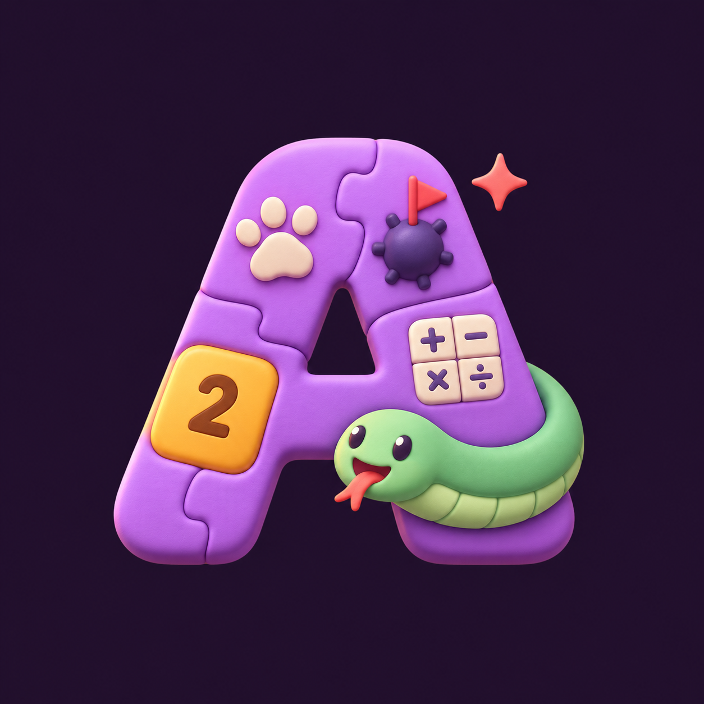

<p align="center">
  
</p>

<h1 align="center">Arcadia</h1>

<p align="center">
  Juegos de lógica y habilidad para Android.<br />
  Seis juegos, controles táctiles y partidas sin conexión.
</p>

<p align="center">
  <a href="https://github.com/Eduarcito/Arcadia/releases"><strong>Descargar APK</strong></a>
  · <a href="#juegos">Juegos</a>
  · <a href="#instalacion">Instalación</a>
  · <a href="#desarrollo">Desarrollo</a>
</p>

---

Arcadia reúne **2048, Buscaminas, Petdoku, Snake, Number Connect y KenKen** en una aplicación Android desarrollada en Kotlin. Elige un juego desde el catálogo ilustrado, juega sin Internet y personaliza la experiencia desde el menú de ajustes.

**Android 8.0 o posterior · Modo claro y oscuro · Controles táctiles**

<a id="juegos"></a>
## Juegos

| Juego | Tu objetivo | Cómo jugar |
|---|---|---|
| **2048** | Combinar fichas en un tablero 4 × 4 hasta alcanzar el 2048. | Desliza en la dirección que quieras mover las fichas. Puedes continuar después de alcanzar la meta. |
| **Buscaminas** | Descubrir las 54 casillas seguras de un tablero 8 × 8 con 10 minas. | Toca para descubrir y mantén pulsado para marcar, o usa el selector de banderas. Incluye una pista por partida, racha y mejor racha. |
| **Petdoku** | Encontrar una mascota por fila, columna y región de color, sin que se toquen. | Un toque marca una ×; dos toques descubren una mascota. Arrastra para marcar o borrar varias notas. Tienes tres vidas por nivel. |
| **Snake** | Comer, crecer y superar tu récord sin chocar con las paredes ni con tu cuerpo. | Desliza para empezar y girar; toca el tablero para pausar o continuar. |
| **Number Connect** | Unir números iguales y conseguir fichas de mayor valor en un tablero 5 × 7. | Arrastra entre casillas vecinas, también en diagonal. Consulta la suma y la ficha final antes de soltar. |
| **KenKen** | Completar un tablero 4 × 4 respetando las operaciones de las jaulas y sin repetir números en filas o columnas. | Usa los modos clásicos o el teclado numérico y pulsa **Comprobar** para revisar la solución. |

### Petdoku: una mascota en cada nivel

Sus **12 niveles de solución única** alternan siete mascotas ilustradas: perrito, gatito, conejito, zorrito, panda, tigre y osito. El tablero y las reglas muestran el animal del nivel actual.

Un intento incorrecto deja una **× roja** y consume una vida. Al completar el tablero, el siguiente nivel comienza automáticamente. Si pierdes las tres vidas, puedes reintentar o volver al menú.

### Number Connect: combina con una vista previa

La tarjeta sobre el tablero muestra la suma mientras trazas la conexión y el valor de la ficha que se formará. Puedes retroceder una casilla para corregir el trazo.

Por ejemplo, **8 + 8 + 8 = 24** produce una ficha de **32**: la suma se redondea hacia arriba a una potencia de dos. La combinación se confirma al soltar el dedo; después, las fichas caen y se rellenan los espacios.

## Características

- **Sin conexión:** todos los juegos funcionan sin Internet ni cuentas.
- **Partidas guardadas:** 2048, Buscaminas, Petdoku, Snake y Number Connect recuperan el progreso al volver a abrirlos.
- **Tableros adaptables:** 2048, Buscaminas, Snake y Number Connect ajustan el tablero al espacio disponible, sin desplazamiento vertical. Petdoku incluye reglas ilustradas compactas.
- **Reintento al perder:** esos cinco juegos ofrecen un diálogo para reintentar o volver al menú principal.
- **Ajustes de juego:** volumen, efectos de sonido, música, vibración y modo claro u oscuro.
- **Ayuda y accesibilidad:** instrucciones de juego, descripciones de casillas y acciones de accesibilidad para los controles compatibles.

El menú de tres líneas abre **Mis juegos** y **Ajustes**. Snake se pausa al salir y espera a que lo reanudes al regresar.

KenKen ofrece cinco rompecabezas predefinidos y conserva el tablero al rotar la pantalla. Su partida no se guarda al cerrar el juego; sí se recuerda la elección entre controles clásicos y teclado numérico. El tema visual es compartido, mientras que los ajustes de audio y vibración se aplican a los demás juegos.

<a id="instalacion"></a>
## Descargar e instalar

1. Abre la sección [Releases](https://github.com/Eduarcito/Arcadia/releases).
2. Elige una versión y descarga el archivo **.apk** de **Assets**.
3. Abre el archivo en tu dispositivo Android. Si el sistema lo solicita, permite instalar aplicaciones desde esa fuente.
4. Completa la instalación y abre **Arcadia**.

**Requisito mínimo:** Android 8.0 — API 26.

<a id="desarrollo"></a>
## Desarrollo

### Antes de modificar el proyecto

Lee las [reglas obligatorias](documentacion/AGENTS.md) y consulta la guía correspondiente. Los cambios deben mantener la documentación alineada con la implementación.

| Guía | Contenido |
|---|---|
| [Estructura](documentacion/docs/estructura.md) | Paquetes, clases, recursos y guardado. |
| [Componentes](documentacion/docs/componentes.md) | Vistas compuestas y reutilización de interfaz. |
| [Diseño](documentacion/docs/diseno.md) | Temas, tarjetas, tableros y controles. |
| [Juegos](documentacion/docs/juegos.md) | Reglas y alcance de cada juego. |
| [Sintaxis](documentacion/docs/sintaxis.md) | Convenciones de Kotlin y ejemplos de XML. |
| [Pruebas](documentacion/docs/pruebas.md) | Validaciones y criterios de entrega. |

Si trabajas con un agente de IA, indícale que lea `documentacion/AGENTS.md` antes de editar. Acuerda con el equipo cualquier cambio que se aparte de estas guías.

### Tecnologías y arquitectura

- **Kotlin** y un único módulo Android: `app`.
- **Vistas XML y View Binding**, con Material Components y ConstraintLayout.
- **Reglas en Kotlin puro** para separar la lógica de la interfaz y facilitar las pruebas.
- **ViewModel** para conservar el estado durante la recreación de las pantallas.
- **SharedPreferences** para las partidas y los ajustes locales.
- **JUnit, Robolectric y Espresso** para las comprobaciones de lógica, guardado e interfaz.

Cada juego agrupa su `Activity`, `ViewModel` y reglas en su propio paquete. La actividad conecta los controles y muestra el estado; el modelo delega las jugadas a las reglas.

Los componentes compartidos viven en `compartido/ui/`. Las pantallas arcade utilizan `PantallaPartidaView`, y los tableros de casillas reutilizan filas y celdas XML. Snake conserva su dibujo interpolado en `Canvas`.

Las partidas se guardan como JSON en `arcade_games`, con las claves `2048`, `mines`, `petdoku`, `snake` y `number_connect`. Los ajustes se almacenan por separado en `arcade_settings`. Conserva estas claves al reorganizar el código para mantener la compatibilidad con las partidas existentes.

### Ubicación del código

Rutas relativas a `app/src/main/java/com/example/arcadia/`. Los layouts se encuentran en `app/src/main/res/layout/`.

| Funcionalidad | Código | Layout principal |
|---|---|---|
| Catálogo | `MainActivity.kt` | `activity_main.xml` |
| Ajustes | `ajustes/` | `activity_arcade_settings.xml` |
| 2048 | `juegos/juego2048/` | `activity_juego_2048.xml` |
| Buscaminas | `juegos/buscaminas/` | `activity_buscaminas.xml` |
| Petdoku | `juegos/petdoku/` | `activity_petdoku.xml` |
| Snake | `juegos/snake/` | `activity_snake.xml` |
| Number Connect | `juegos/numberconnect/` | `activity_number_connect.xml` |
| KenKen | `juegos/kenken/` | `activity_kenken.xml` |
| Componentes y estado compartidos | `compartido/ui/`, `compartido/estado/` | Plantillas reutilizables |

### Abrir y ejecutar

1. Clona el repositorio y abre su carpeta raíz en **Android Studio**.
2. Usa una versión de Android Studio compatible con el Android Gradle Plugin definido en [libs.versions.toml](gradle/libs.versions.toml).
3. Instala el SDK indicado en [app/build.gradle.kts](app/build.gradle.kts) y sincroniza Gradle.
4. Selecciona el módulo **app** y un dispositivo o emulador con API 26 o posterior.
5. Pulsa **Run** para compilar, instalar y abrir la aplicación.

Para generar un APK de depuración desde PowerShell:

```powershell
.\gradlew.bat :app:assembleDebug
```

El archivo se genera en `app/build/outputs/apk/debug/app-debug.apk`.

### Comprobaciones

Compilación, pruebas locales y análisis estático:

```powershell
.\gradlew.bat :app:assembleDebug :app:testDebugUnitTest :app:lintDebug
```

Pruebas de interfaz con un emulador o dispositivo de prueba conectado:

```powershell
.\gradlew.bat :app:connectedDebugAndroidTest
```

> Ejecuta la suite de interfaz en un dispositivo de prueba: `ArcadeFlowTest` borra las preferencias de partidas y ajustes.

Las pruebas cubren las reglas de los juegos, gestos, guardado, navegación, diálogos de fin de partida, mascotas y avance de Petdoku, previsualización de Number Connect y controles de KenKen. Consulta la [guía de pruebas](documentacion/docs/pruebas.md) para conocer los escenarios de cada suite.

## Recursos visuales

El catálogo combina ilustraciones dibujadas en código con las mascotas de Petdoku. El icono de la app y las mascotas se incluyen como recursos locales, por lo que no requieren descargas durante el juego.

La [documentación de las mascotas](documentacion/mascotas_por_nivel.md) recoge las imágenes, su distribución por nivel y los prompts utilizados para crearlas.
